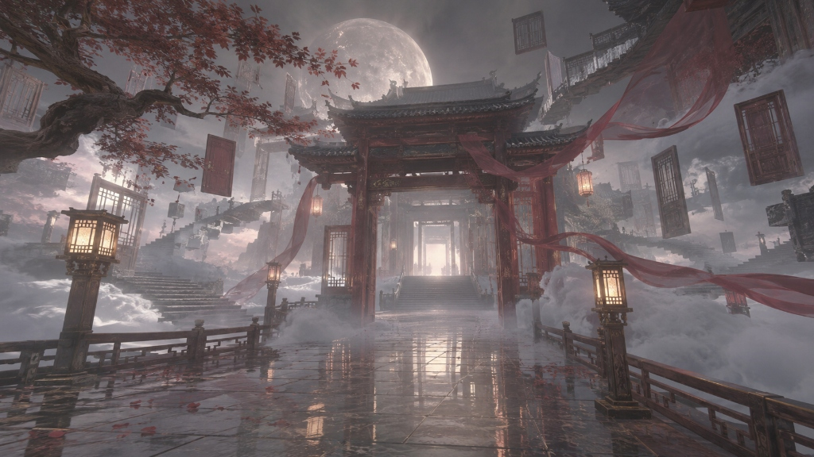

# 朔夜 · 能力与习惯

> 烈浑之力的锋锐战者，亦是掌握梦台、缝合灵魂的裁梦之人。

---

## 战力体系与能级表现

### 1. 武力体系 · 玄二。

### 2. 魔法能层 · 烈·浑（M·3s）

---

## 使徒生命机制

承明历81年1月8日完成使徒化转变后，朔夜获得了全新的生命与能量底层：

- **脱离碳基代谢**：肉身以洋能作为维持核心，生理指标不再受常规碳基生物极限的约束，拥有极强的抗冲击力与自我修复力。
- **反向代理供能**：朔夜与茉璃建立了高维魔力供给链。茉璃庞大无垠的亚空间洋能作为“后台源服务器”，朔夜则通过专属接口按需调用。这使他在本地泡这种自然魔力稀薄的环境中，依然能够维持烈层高强度的连续作战，彻底摆脱了常规跨越者“续航不足”的致命短板。
- **环境适应性**：在洋能浓度极高的异常区域或裂隙附近，普通人类会感到窒息甚至导致洋溺，而使徒形态的朔夜反而会感到通体舒畅、感知敏锐度大幅提升。

---

## 核心权能

自承明历81年中秋接掌古代天选者望舒的传承后，朔夜掌握了涉足意识与梦境深层的至高法门。他在完整保留望舒传授的原典形态的同时，结合自身使徒质地对信息的敏锐度，二次开发出了专属于自己的攻击性领域，形成了“原典引渡”与“阈限侵蚀”并存的双相体系：

### 1.白玉高台

朔夜完全保留并兼容望舒传授的梦台形态：
- **直面可能性镜像**：在目标心神自愿或防线松动时，可将其意识引渡至白玉融水般的古老高台之上，直面因不同人生抉择而分化的“可能性平行人生”。
- **抚平执念**：台上之人能够看清未竟的遗憾与分支走向，抚平神魂深层的创伤与心结，亦可用作洞察他人隐秘内心的温和手段。

### 2. 阈限空间（灵魂系特殊攻击 · 非致命认知扭曲）

在彻底吃透梦台底层调度法门后，朔夜跳脱出单一高台意象，二次开发出了构建“阈限空间（Liminal Space）”梦境的独特领域。

**这是朔夜作为灵魂系修行者的特殊攻击能力，但它往往并不致命。**

与传统灵魂系术式依靠厉鬼撕咬、恶兽咆哮或精神剧痛压迫不同，朔夜的攻击无声无息，甚至让陷入其中的人毫无受袭的自觉：
- **无痕认知扭曲**：它只会在对手毫无防备的时刻，自然地扭曲其对现实世界的认知；
- **生活感的荒芜**：空间呈现出**“仿佛一直有人生活着，却已经很久没有人来过”**的奇特静谧。水壶可能是温热的，仪表仍在平稳走字，石板路泛着刚被擦拭过的水痕，但放眼望去空无一人；
- **理论成立与现实虚无**：空间内的建筑力学、力流走势、管线排布或楼阁榫卯，在工程与理论上完全自洽可行，但在物理现实中**绝无真实的地理坐标**；
- **临界态的虚实溶解**：车站、门廊、连廊、古道——空间永远处于“前往某处”的中转过渡态。正是这种悬停在两种状态之间、界限模糊的临界感，会让坠入其中的对手在极度舒适与既视感中，悄然丧失对“梦境”与“现世”的判定锚点，对抗意志与警惕心在不知不觉中被彻底瓦解。

#### 三大常驻阈限空间构象：

1. **无尽花海中的车站**：
   一望无际、延绵至地平线尽头的繁密花海，微风拂动花浪，带来清甜的花香与极淡的机油味。花海正中突兀矗立着一座空无一人的现代铁路站台。雨棚整洁，长椅冰凉，铁轨笔直伸向远方白茫茫的雾气中。时刻表停留在某个不存在的班次，却永远等不来进站的汽笛，亦没有回程的列车。

2. **六十年代眼中的未来**：
   承明历59年公开日之后，望城，星月湾等城市率先全面接纳跨越者，并将魔力生态与洁净科技融入对未来的热望中。这股风潮在此后二十年间席卷全球，形成了全大陆对“新纪元”最纯粹、最乐观的集体想象。
   空间展现为承明历六十年代人们所构想的未来都市：澄澈如洗的湛蓝高空、高透光的巨大流线型玻璃穹顶、白瓷与翠绿相间的生态连廊。墙面泛着如露珠般晶莹的水光质感，透明管道内流淌着温润的净水与发光游鱼，微风轻拂过一尘不染的公共中庭，空气中回荡着空灵悠扬的合成器轻音乐。没有工业污染，没有阴霾争端，整个世界凝固在对未来最明朗的憧憬中，宛如一座巨大而永不褪色的洁净展馆。

3. **千年前的华夏古风**：
   既非现实中斑驳的砖木古迹，亦非神魔志怪中虚无缥缈的云上仙境，而是一处**“似曾相识、却永远无法真正抵达”**的古梦之墟。
   天幕低垂，一轮硕大而清冷的皎月静止在朱漆古刹的飞檐之后。红绸如凝固的流水般悬浮在半空，重重楼阁长廊半掩在流动的水汽与云雾深处。湿漉平整的青黑石板路上，倒映着长明灯笼微弱摇曳的暖光。穿过洞开的中门，远方浮云之间还悬浮着一重又一重不知通往何处的门框与蜿蜒石阶。这里仿佛前夜刚刚散去一场盛大的宫宴，杯盏未凉，唯余长风穿堂。

   
